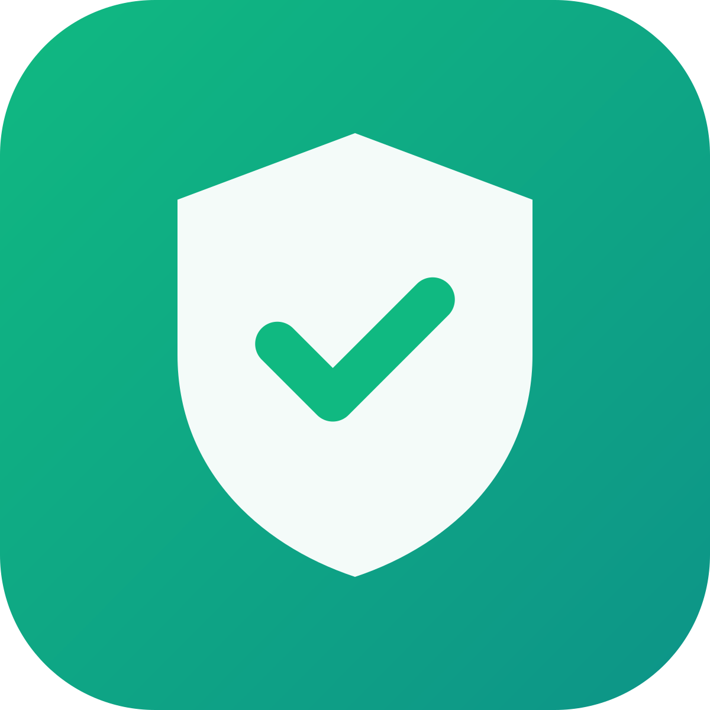
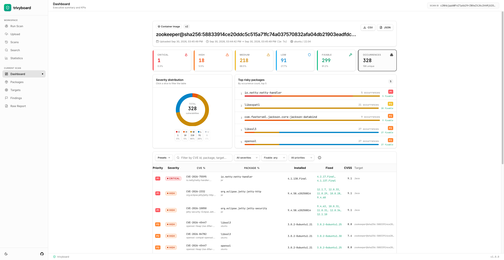
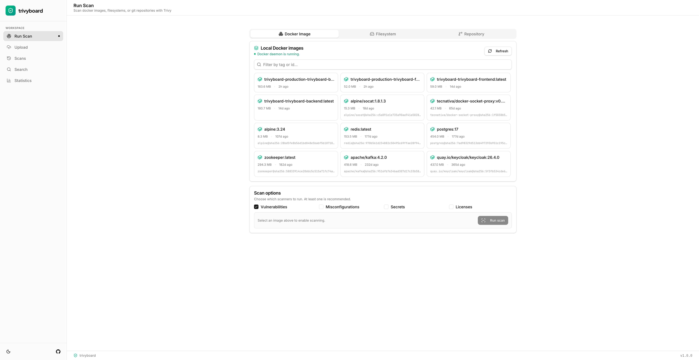
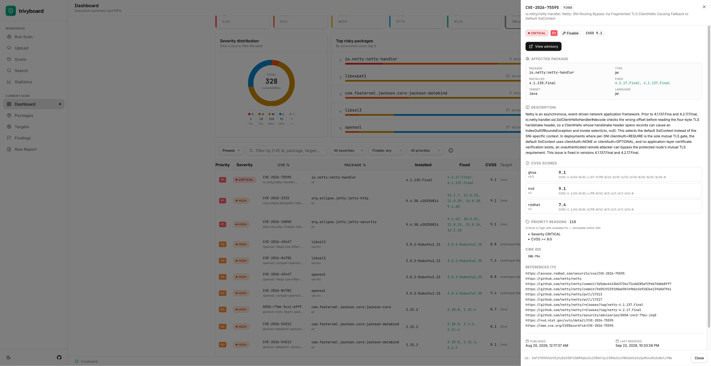
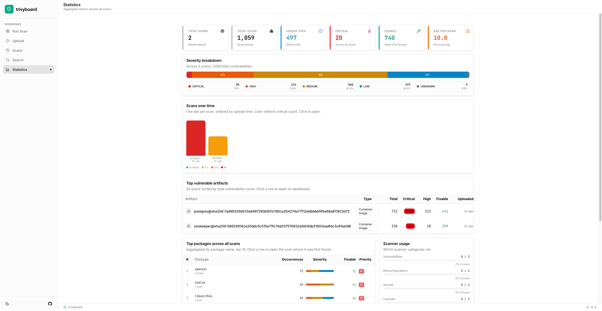

<div align="center">

# 

**A vulnerability dashboard for [Aqua Security Trivy](https://trivy.dev)**

Scan Docker images, filesystems, and Git repositories; then triage vulnerabilities through an interactive dashboard with severity charts, prioritized package lists, and vulnerability tables.

[](https://vuejs.org/)
[](https://go.dev/)
[]()
</div>

---

## Screenshots












## Features

### Three Ways to Scan
- **Docker Image** - list local Docker images (via Docker Engine API) and scan one with `trivy image`
- **Filesystem** - scan a directory with `trivy fs`
- **Repository** - scan a Git URL or local repo with `trivy repo`
- **Upload** - drop an existing `trivy --format json` report file

### Interactive Dashboard
- **Top risky packages** - ranked by transparent P0–P4 priority score
- **Vulnerabilities table** - severity/fixable/priority filters, sortable columns, and quick-filter presets
- **Detail drawer** - CVSS scores per source, description, references, CWE IDs, dates, priority reasons
- **Packages / Targets / Findings views** - drill-down by package, target, or non-vulnerability finding (misconfigurations, secrets, licenses)
- **Statistics** - aggregate metrics across all stored scans (severity breakdown, scans-over-time chart, top artifacts, top packages, scanner usage)
- **Global Search** - find a CVE or package across all scans
- **CSV / JSON export** - respects current filters

## Quick Start

### Option 1: Docker Compose

```bash
git clone https://github.com/fatihsaracoglu/trivyboard.git
cd trivyboard
cp .env.example .env
docker compose up --build
```

Open `http://localhost:8080`

### Option 2: Local Development

### Prerequisites

| Tool  | Purpose |
|------|---------|
| [Node.js](https://nodejs.org/)  | Frontend runtime |
| [Bun](https://bun.sh/) | Package manager |
| [Go](https://go.dev/) | Backend compilation |
| [Trivy](https://trivy.dev/) | Vulnerability scanning |
| [Docker](https://docker.com/) | Docker image scanning |

```bash
# 1. Clone
git clone https://github.com/fatihsaracoglu/trivyboard.git
cd trivyboard

# 2. Install frontend deps
bun install

# 3. Build the Go backend
cd trivyboard-backend && go build -o trivyboard-backend-bin . && cd ..

# 4. Set env vars (fs scans require SCANNABLE_ROOTS)
export SCANNABLE_ROOTS="/tmp,/home/user/projects"
export ALLOWED_GIT_HOSTS="github.com,gitlab.com"

# 5. Configure .env file (see .env.example)
cp .env.example .env

# 6. Run both servers
cd trivyboard-backend && go run .   # backend on :3030 by default
bun run dev                    # frontend on :3000 by default
```

Open `http://localhost:3000`

## Security

- **Filesystem scan paths** are validated server-side: resolved through symlinks and checked against `SCANNABLE_ROOTS`. Dangerous system paths (`/`, `/etc`, `/var`, `/proc`, `/sys`, `/dev`, `/boot`, `/root`) are always rejected.
- **Git repository scans** require HTTPS URLs with hosts in `ALLOWED_GIT_HOSTS`. Local repo paths are validated against `SCANNABLE_ROOTS`.
- **Scanner allow-list** - only `vuln`, `misconfig`, `secret`, `license` are accepted; arbitrary values are rejected.

## Contributing

Contributions are welcome! To submit a change:

1. Fork the repository and clone your fork.
2. Create a branch with a descriptive name: `git checkout -b feature/your-feature`.
3. Make your changes and add or update tests as needed.
4. Run the test suite: `bun run test`.
5. Commit your changes with a clear message: `git commit -m "Describe your changes"`.
6. Push your branch: `git push origin feature/your-feature`.
7. Open a pull request describing what changed and why.

## License

This project is licensed under the GNU GPLv3 License - see the [LICENSE](LICENSE) file for details.

## Acknowledgements

Thanks to the teams behind the tools that power this project:

- [Aqua Security](https://aquasecurity.github.io/) for [Trivy](https://trivy.dev/), the security scanner
- [Go](https://go.dev/) for the programming language powering the backend
- [Vue.js](https://vuejs.org/) for the frontend framework
- [Tailwind CSS](https://tailwindcss.com/) for the utility-first CSS framework
